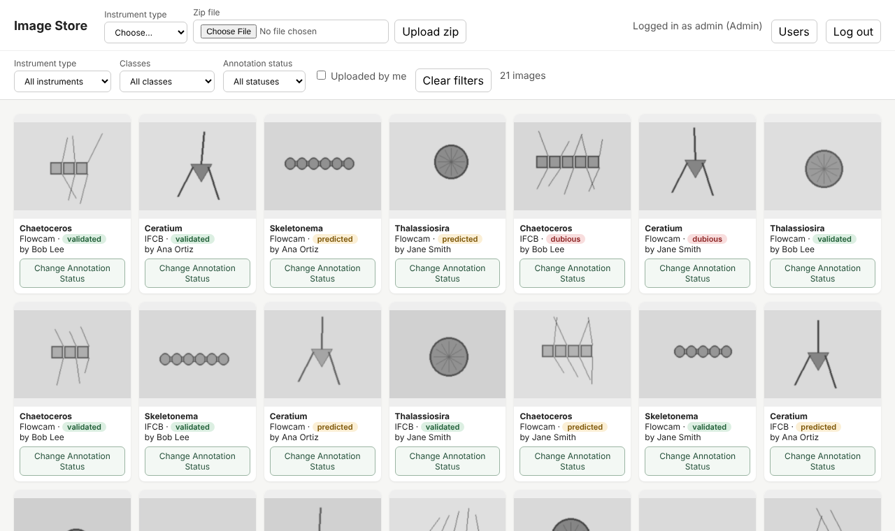
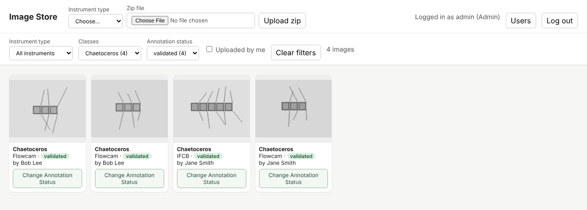
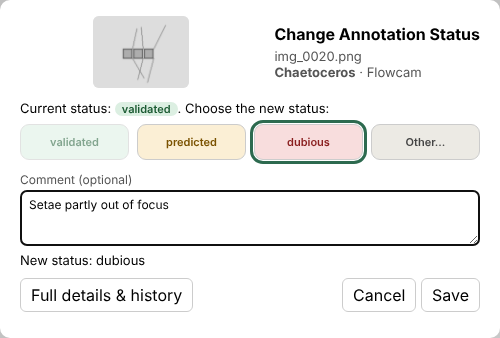
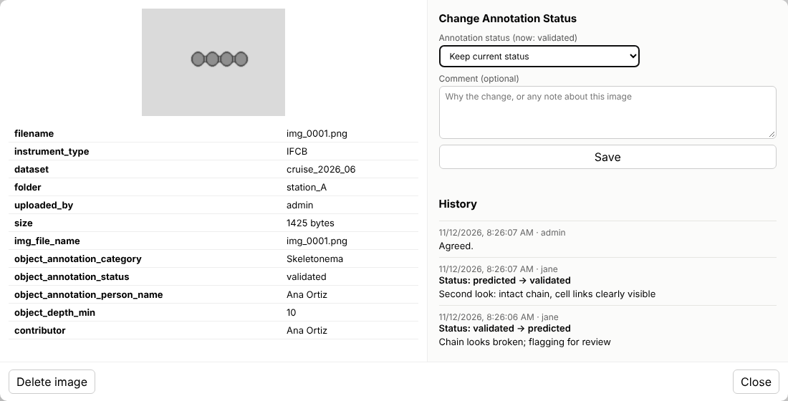
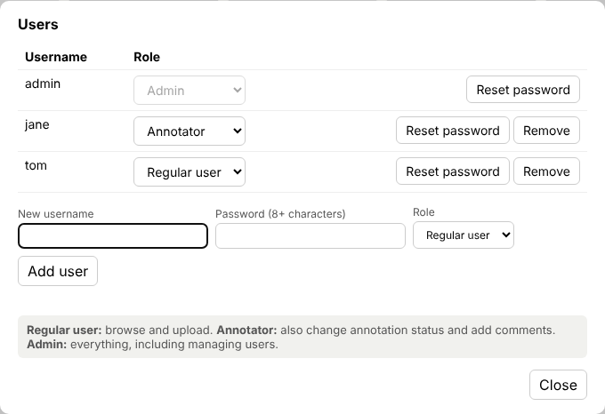
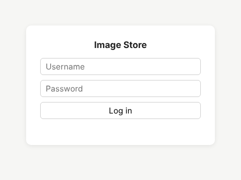
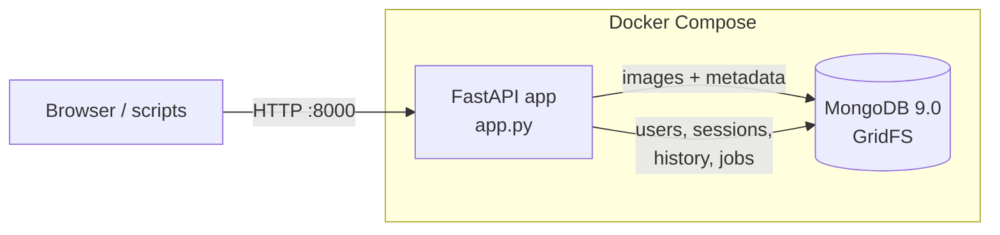

# Plankton Image Store

A self-hosted web app for storing, browsing and annotating phytoplankton images from
**IFCB**, **PlanktoScope** and **FlowCam** instruments. Images and their metadata are
kept in MongoDB. Users log in, upload zip files of images with TSV metadata
(EcoTaxa-style exports work out of the box), filter the collection by instrument,
species and annotation status, and review annotations with a full change history.

Everything runs in Docker with one command.



---

## Contents

- [Features](#features)
- [Screenshots](#screenshots)
- [How it works](#how-it-works)
- [Quick start](#quick-start)
- [Preparing your data](#preparing-your-data)
- [Using the web app](#using-the-web-app)
- [Users and roles](#users-and-roles)
- [Annotation history](#annotation-history)
- [Configuration](#configuration)
- [REST API](#rest-api)
- [Command-line user management](#command-line-user-management)
- [Data model](#data-model)
- [Operations: updates, backups, logs](#operations-updates-backups-logs)
- [Security](#security)
- [Troubleshooting](#troubleshooting)
- [Project structure](#project-structure)

---

## Features

- **Bulk upload of zip files**: folders of images plus TSV metadata. Large files are streamed to disk and processed in the background, with live progress.
- **Automatic metadata matching**: each TSV row is matched to its image by file name, without any configuration. EcoTaxa's second header row of column types (`[t]`/`[f]`) is skipped.
- **Instrument type** (IFCB, PlanktoScope, FlowCam) is chosen for each upload.
- **Three combinable filters**: *Instrument type*, *Classes* (species, from `object_annotation_category`) and *Annotation status* (`object_annotation_status`). Each dropdown's counts update to match the other choices.
- **Contributor tracking**: each image's `contributor` comes from `object_annotation_person_name`, and `uploaded_by` records who uploaded it.
- **Annotation review**: every image card has a **Change Annotation Status** button for switching between validated, predicted and dubious (or another status), with an optional comment. Every change is kept in a permanent history (who, when, old value, new value, comment).
- **Logins and roles**: regular user, annotator and admin, with a user management window for admins.
- **REST API** with interactive documentation at `/docs`, and token login for scripts.
- **Duplicate-safe uploads**: re-uploading the same zip only adds the images that are missing.

## Screenshots

| Filter by instrument, species and status | Change Annotation Status |
|---|---|
|  |  |

| Image details with annotation history |
|---|
|  |

| Manage users and roles | Login |
|---|---|
|  |  |

## How it works



- **`app`**: a Python [FastAPI](https://fastapi.tiangolo.com/) service. It serves the web page and the REST API, unpacks uploaded zips, and enforces logins and roles.
- **`mongo`**: MongoDB 9.0. Images are stored with [GridFS](https://www.mongodb.com/docs/manual/core/gridfs/), which splits each file into chunks, so file size isn't limited by MongoDB's 16 MB document limit. Each image's metadata sits next to it.
- **Persistence**: data lives in Docker volumes, so it survives restarts, rebuilds and upgrades.

## Quick start

### Requirements

- Linux, macOS or Windows with Docker and Docker Compose v2. Instructions below are for Ubuntu.
- About 1 GB of disk for the containers, plus space for your images.

### 1. Install Docker (Ubuntu)

```bash
sudo apt update
sudo apt install -y docker.io docker-compose-v2
sudo usermod -aG docker $USER
newgrp docker            # or log out and back in
```

### 2. Get the code and set your admin password

```bash
git clone https://github.com/<your-account>/plankton-image-store.git
cd plankton-image-store
cp .env.example .env
nano .env                # set ADMIN_PASSWORD (Ctrl+O, Enter, Ctrl+X to save and exit)
```

### 3. Start

```bash
docker compose up -d --build
docker compose ps        # mongo should be "healthy", app "running"
```

Open **http://localhost:8000** and log in as `admin` with the password from `.env`.
Other computers on your network can use `http://<this-machine's-IP>:8000`.

### 4. Stop / start again

```bash
docker compose down      # stop (all data is kept)
docker compose up -d     # start again
```

The containers restart automatically after a reboot.

## Preparing your data

Upload a **zip file**. Each folder inside holds images and a TSV file describing them:

```
cruise_2026_06.zip
├── station_A/
│   ├── ecotaxa_station_A.tsv     <- any .tsv inside the folder...
│   ├── img_0001.png
│   └── img_0002.png
├── station_B.tsv                 <- ...or a .tsv next to the folder with the same name
└── station_B/
    ├── img_0101.jpg
    └── ...
```

- **Image formats**: `.jpg`, `.jpeg`, `.png`, `.gif`, `.webp`, `.bmp`, `.tif`, `.tiff`.
- **Matching rows to images**: the app finds the TSV column holding the image file names (e.g. `img_file_name`). It works with or without the file extension or a leading path. If it picks the wrong column, name the right one with the `key_column` field in the API.
- **Stored metadata**: every TSV column is stored with the image. Numbers are stored as numbers, so you can filter on them.
- **Images without a TSV row**: they're still stored, with no metadata.
- **Junk files**: macOS leftovers (`__MACOSX/`, `._*`) and hidden files are ignored.
- **Dataset name**: by default, the zip's file name.

### Metadata columns the app uses

| Column | Used for |
|---|---|
| `object_annotation_category` | **Classes** dropdown (species) |
| `object_annotation_status` | **Annotation status** dropdown, and editable by annotators |
| `object_annotation_person_name` | `contributor` (falls back to the uploader's username if blank) |

These names match EcoTaxa exports and can be changed in `.env` (see [Configuration](#configuration)).

Example TSV:

```tsv
img_file_name	object_annotation_category	object_annotation_status	object_annotation_person_name	object_depth_min
[t]	[t]	[t]	[t]	[f]
img_0001.png	Chaetoceros	validated	Jane Smith	5
img_0002.png	Skeletonema	predicted	Jane Smith	5
```

## Using the web app

### Uploading

1. Pick the **Instrument type** (required) and choose a **Zip file**.
2. Click **Upload zip**. The status next to the button counts images as they're stored, and the gallery refreshes when the upload is done.

Uploading the same zip again only adds images that are missing. Duplicates are detected by dataset, folder, uploader and file name.

### Browsing and filtering

- **Instrument type**, **Classes** and **Annotation status** can be combined, e.g. *FlowCam + Chaetoceros + validated*.
- Each option shows how many images match, given the other filters. Images with a blank value appear under **(none)**.
- **Uploaded by me** shows only your own uploads, and **Clear filters** resets everything.
- Click an image to see all its metadata, its annotation history and (for annotators) the annotation form.
- Cards with history show a ✎ count.

## Users and roles

| Role | Browse & upload | Read history | Change status / comment | Delete images | Manage users |
|---|:-:|:-:|:-:|:-:|:-:|
| **Regular user** | ✓ | ✓ | | own uploads | |
| **Annotator** | ✓ | ✓ | ✓ | own uploads | |
| **Admin** | ✓ | ✓ | ✓ | any | ✓ |

- **Managing users**: admins click **Users** to add people, change roles, reset passwords or remove accounts. Role changes take effect immediately.
- **Lockout protection**: you can't remove your own admin role, and the last admin can't be demoted.
- **Removed users**: their images and history entries are kept.
- **First admin**: created from `ADMIN_USERNAME`/`ADMIN_PASSWORD` the first time the app starts with an empty database.

## Annotation history

### Changing an image's status

Every image card has a **Change Annotation Status** button (annotators and admins):

1. Click **Change Annotation Status** on the card.
2. Click the new status: **validated**, **predicted**, **dubious**, any other status already in the data, or **Other…** to type a new one. The current status is greyed out.
3. Optionally add a comment explaining the change, then click **Save**.

The card updates straight away, and so do the dropdown counts. The window also shows the image's three most recent changes. **Full details & history** opens the image's detail window, which has the same form, all its metadata and the complete history. You can also add a comment there without changing the status.

Regular users see the button too, but get a note that they need annotator access.

### What is recorded

- **Each save:** a permanent entry in the `annotation_history` collection, with the time, the user and their role, the old and new status, and the comment.
- **Entries are never edited,** and they're kept even if the image is deleted.
- **What changes on the image:** only `object_annotation_status`. Its `contributor` (the original annotator) stays the same, and the latest change is recorded in `last_change`.
- **Where to see it:** each image's **History** list, or across all images through the API (`GET /history?user=jane`).

## Configuration

All settings live in `.env` (copy `.env.example`). After changing them, run `docker compose up -d`.

| Variable | Default | Meaning |
|---|---|---|
| `ADMIN_USERNAME` | `admin` | First admin account (created only when there are no users yet) |
| `ADMIN_PASSWORD` | *(required)* | Its password |
| `PORT` | `8000` | Port the web app is served on |
| `COOKIE_SECURE` | `false` | Set `true` when serving over HTTPS |
| `SESSION_DAYS` | `7` | How long a login lasts |
| `INSTRUMENTS` | `IFCB,Planktoscope,Flowcam` | Instrument types offered at upload |
| `LEGACY_INSTRUMENT` | `Flowcam` | Assigned to images stored before instrument types existed |
| `CLASS_FIELD` | `object_annotation_category` | Column behind the **Classes** dropdown |
| `STATUS_FIELD` | `object_annotation_status` | Column behind **Annotation status** |
| `STATUS_CHOICES` | `validated,predicted,dubious` | Statuses always offered when editing |
| `PERSON_FIELD` | `object_annotation_person_name` | Column used for `contributor` |
| `IMAGE_DB` | `image_db` | MongoDB database name |

## REST API

Interactive documentation, where you can try every call, is at **http://localhost:8000/docs**.

### Authentication

Log in once to get a token, then send it with each request. A browser login uses a cookie instead.

```bash
TOKEN=$(curl -s -F username=jane -F password='...' http://localhost:8000/login \
        | python3 -c 'import sys,json;print(json.load(sys.stdin)["token"])')
AUTH="Authorization: Bearer $TOKEN"
```

### Examples

```bash
# Upload a zip (FlowCam data)
curl -H "$AUTH" -F instrument=Flowcam -F "file=@cruise_2026_06.zip" http://localhost:8000/datasets
# -> {"job_id": "...", "status_url": "/jobs/..."}

# Check upload progress
curl -H "$AUTH" http://localhost:8000/jobs/<job_id>

# Upload a single image with metadata
curl -H "$AUTH" -F instrument=IFCB -F "file=@img.png" \
     -F 'metadata={"object_annotation_category":"Chaetoceros","object_annotation_status":"predicted"}' \
     http://localhost:8000/images

# Validated Chaetoceros images from the FlowCam
curl -H "$AUTH" "http://localhost:8000/images?instrument=Flowcam&class=Chaetoceros&status=validated&limit=100"

# Download an image
curl -H "$AUTH" -o img.png http://localhost:8000/images/<image_id>/file

# Change status with a comment (annotators and admins)
curl -H "$AUTH" -F status=validated -F comment="Clear setae" http://localhost:8000/images/<image_id>/annotations

# An image's history, and recent changes by one person
curl -H "$AUTH" http://localhost:8000/images/<image_id>/history
curl -H "$AUTH" "http://localhost:8000/history?user=jane"
```

### Endpoints

| Method | Path | Access | Purpose |
|---|---|---|---|
| `POST` | `/login` | public | Log in (form: `username`, `password`), returns a token |
| `POST` | `/logout` | public | End the browser session |
| `GET` | `/me` | logged in | Your username and role |
| `POST` | `/me/password` | logged in | Change your password |
| `GET` | `/roles` | public | Available roles |
| `GET` | `/instruments` | public | Instrument types |
| `POST` | `/datasets` | logged in | Upload a zip (`file`, `instrument`, optional `dataset`, `key_column`) |
| `GET` | `/jobs/{job_id}` | uploader / admin | Upload progress and counts |
| `DELETE` | `/datasets/{dataset}` | logged in | Delete your images in a dataset (admins: everyone's) |
| `POST` | `/images` | logged in | Upload one image (`file`, `instrument`, optional `metadata` JSON) |
| `GET` | `/images` | logged in | List and filter images (see below) |
| `GET` | `/images/{id}` | logged in | One image's metadata |
| `GET` | `/images/{id}/file` | logged in | The image file |
| `DELETE` | `/images/{id}` | uploader / admin | Delete an image |
| `POST` | `/images/{id}/annotations` | annotator / admin | Change status and/or add a comment |
| `GET` | `/images/{id}/history` | logged in | That image's history, newest first |
| `GET` | `/history` | logged in | Recent changes across all images (`?user=`) |
| `GET` | `/facets` | logged in | Dropdown options with counts (accepts the same filters as `/images`) |
| `GET` | `/status-choices` | logged in | Statuses offered when editing |
| `GET` | `/contributors` | logged in | Contributors with image counts |
| `GET` | `/users` | admin | List users |
| `POST` | `/users` | admin | Add a user (`username`, `password`, `role`) |
| `POST` | `/users/{username}/role` | admin | Change a role |
| `POST` | `/users/{username}/password` | admin | Reset a password (logs them out) |
| `DELETE` | `/users/{username}` | admin | Remove a user |

**`GET /images` filters**: `instrument`, `class` (species), `status`, `dataset`, `folder`,
`contributor`, `mine=true` (your uploads), `attr.<column>=<value>` for any metadata column
(e.g. `attr.object_depth_min=5`), and `(none)` for blank values. Pagination uses `limit`
(maximum 500) and `skip`.

## Command-line user management

```bash
docker compose exec app python manage_users.py add alice                   # regular user; asks for a password
docker compose exec app python manage_users.py add jane --role annotator
docker compose exec app python manage_users.py add greg --role admin
docker compose exec app python manage_users.py role alice annotator        # change a role
docker compose exec app python manage_users.py passwd alice                # reset a password
docker compose exec app python manage_users.py list
docker compose exec app python manage_users.py remove alice
```

If you forget the admin password, reset it with `passwd`.

## Data model

All data is in the MongoDB database `image_db`:

| Collection | Contents |
|---|---|
| `images.files` | One document per image: GridFS file info plus `metadata` (below) |
| `images.chunks` | The image bytes (GridFS) |
| `annotation_history` | One document per status change or comment |
| `users` | Usernames, bcrypt password hashes, roles |
| `sessions` | Login tokens (expired ones are deleted automatically) |
| `jobs` | Zip upload progress and results |

Image `metadata` fields:

| Field | Meaning |
|---|---|
| `instrument` | IFCB / Planktoscope / Flowcam (chosen at upload) |
| `dataset` | Dataset name (zip file name by default) |
| `folder` | Folder inside the zip the image came from |
| `attributes` | Every TSV column for that image, plus `contributor` |
| `contributor` | From `object_annotation_person_name`, or the uploader |
| `uploaded_by` | Username of the uploader (controls delete rights) |
| `contentType`, `sourcePath`, `uploadedAt`, `job_id` | Upload details |
| `history_count`, `last_change` | Annotation history summary |

To look at the data directly:

```bash
docker compose exec mongo mongosh image_db
> db.images.files.findOne()
> db.annotation_history.find().sort({changed_at: -1}).limit(5)
```

[MongoDB Compass](https://www.mongodb.com/products/tools/compass) can connect from the host machine at `mongodb://localhost:27017`.

## Operations: updates, backups, logs

**Update to a new version**

```bash
git pull
docker compose up -d --build
```

Data is kept. Any changes the new version needs to existing data are applied automatically when it starts.

**Back up**

```bash
mkdir -p backups
docker compose exec -T mongo mongodump --db image_db --archive --gzip > backups/image_db_$(date +%F).archive.gz
```

**Restore** (this replaces the current data)

```bash
docker compose exec -T mongo mongorestore --archive --gzip --drop < backups/image_db_YYYY-MM-DD.archive.gz
```

**Logs**

```bash
docker compose logs -f app       # web app and zip processing
docker compose logs mongo        # database
```

**Delete everything** (images, users, history): `docker compose down -v`

Data lives in the Docker volumes `image-store_mongo-data` (database) and `image-store_uploads`
(temporary upload files). The project name is fixed in `docker-compose.yml`, so the same
volumes are used whatever the folder is called.

## Security

- **Passwords**: stored as bcrypt hashes. Login sessions are random tokens that expire after `SESSION_DAYS`.
- **Secrets**: `.env` holds your admin password and is excluded from git by `.gitignore`. Never commit it.
- **Database access**: MongoDB is only reachable from the host machine (`127.0.0.1`), so other computers can't bypass the logins by connecting to the database directly.
- **HTTPS**: the app serves plain HTTP. That's fine on a trusted network, but before exposing it to the internet:
  1. Put it behind HTTPS with a reverse proxy such as [Caddy](https://caddyserver.com/) or nginx.
  2. Set `COOKIE_SECURE=true`.
  3. Raise the proxy's upload size limit for large zips (nginx: `client_max_body_size`).

## Troubleshooting

| Problem | Fix |
|---|---|
| `no configuration file provided: not found` | Run `docker compose` from the folder containing `docker-compose.yml`. |
| `Set ADMIN_PASSWORD in the .env file` | `cp .env.example .env` and set a password. |
| `permission denied ... docker.sock` | Run `sudo usermod -aG docker $USER`, then log out and back in. |
| MongoDB exits with *"Linux kernel versions 6.19 and newer has a known incompatibility"* | Use MongoDB **9.0.4 or newer** (the default `mongo:9.0` image). Run `docker compose pull mongo && docker compose up -d`. |
| `mongo` keeps restarting with `Illegal instruction` | The CPU lacks AVX, which MongoDB 5.0+ requires. In a VM, set the CPU type to "host". |
| Port 8000 already in use | Set `PORT=8080` in `.env` and run `docker compose up -d`. |
| Upload shows `without_metadata` > 0 | Those images had no matching TSV row. Check the file-name column, or pass `key_column` through the API. |
| Forgot the admin password | Run `docker compose exec app python manage_users.py passwd admin`. |

## Project structure

```
.
├── app.py               # FastAPI app: API, web page, zip processing, auth, history
├── manage_users.py      # Command-line user management
├── Dockerfile           # App container
├── docker-compose.yml   # App + MongoDB services and volumes
├── requirements.txt     # Python dependencies
├── .env.example         # Settings template (copy to .env)
├── .gitignore
└── docs/                # Screenshots used in this README
```

## Built with

[FastAPI](https://fastapi.tiangolo.com/) · [MongoDB](https://www.mongodb.com/) + GridFS ·
[PyMongo](https://pymongo.readthedocs.io/) · [bcrypt](https://pypi.org/project/bcrypt/) · Docker Compose

## License

No license has been chosen yet. See [choosealicense.com](https://choosealicense.com/) to add one.
